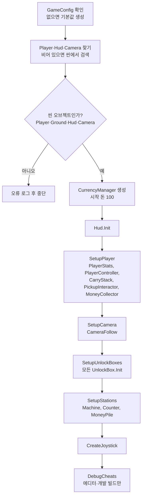
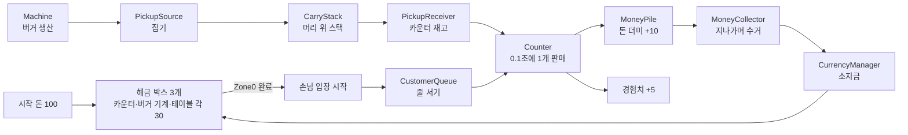
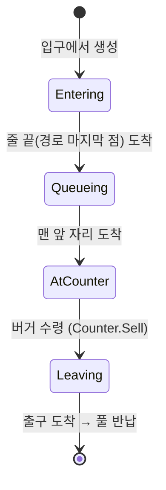

# Burger Idle — 개발 위키

> 코드 구조와 작업 규칙을 정리한 문서다. 기획은 [GDD.md](GDD.md), 진행 상황은 [Checklist.md](Checklist.md)를 본다.
> 기준 시점: P5 완료 (핵심 루프 1바퀴: 생산 → 운반 → 판매 → 돈 더미 → 수거)

---

## 1. 개요

| 항목 | 내용 |
| --- | --- |
| 장르 | 3D 쿼터뷰 레스토랑 운영 아이들 (레퍼런스: Burger Please!) |
| 엔진 | Unity 6000.3.25f1, URP 17.3 |
| 입력 | Input System 1.20 (레거시 `UnityEngine.Input` 사용 금지) |
| 반응형 상태 | R3 1.3.1 (`using R3;`, UniRx API 사용 금지) |
| 연출 | DOTween Pro (`using DG.Tweening;`) |
| UI 텍스트 | TextMeshPro |
| 플랫폼 | Android 세로 화면 (에디터 테스트는 Game 뷰 1080×1920) |
| 씬 | `Assets/Scenes/MainScene.unity` 하나 |

---

## 2. 핵심 설계 원칙

### 2.1 씬 배치 + 컴포넌트

- **맵에 고정된 오브젝트**(바닥, 플레이어, 카운터, 기계, 테이블, 쓰레기통, 해금 박스, 손님 줄)는 프리팹으로 만들어 **씬에 직접 배치**한다. 위치는 씬에서 눈으로 보며 잡는다.
- **실행 중 생겼다 사라지는 오브젝트**(음식, 쓰레기, 돈, 손님)만 코드가 `ObjectPools`로 생성한다.
- `GameBootstrap`은 오브젝트를 만들지 않고 **씬 오브젝트끼리 연결**만 한다. 예외는 조이스틱 UI 하나(코드 생성).
- `.unity` / `.prefab` 파일은 텍스트로 직접 편집하지 않는다. 에디터에서 작업한다.

### 2.2 R3 상태 관리

- 재화, 스탯, 개수 같은 상태는 `ReactiveProperty<T>`에 보관하고, 외부에는 `ReadOnlyReactiveProperty<T>`로만 노출한다.
- UI·연출은 `Update()` 폴링이 아니라 `Subscribe`로 갱신한다.
- 모든 구독과 `ReactiveProperty`는 `.AddTo(this)`로 해제를 보장한다.

```csharp
readonly ReactiveProperty<int> count = new ReactiveProperty<int>(0);
public ReadOnlyReactiveProperty<int> Count => count;

void Awake() => count.AddTo(this);
```

### 2.3 재화 단일 진입점

- 돈·경험치 증감은 **반드시 `CurrencyManager`** 를 거친다. 음수 방지·최대값 검증은 이 클래스 안에서만 한다.
- 판매 수익과 팁은 바로 소지금이 되지 않는다. `MoneyPile`에 쌓였다가 플레이어가 수거할 때 `CurrencyManager.Add()`가 호출된다.

### 2.4 수치는 데이터로

밸런스 값은 코드에 하드코딩하지 않고 ScriptableObject에 둔다.

| 에셋 | 생성 메뉴 | 내용 |
| --- | --- | --- |
| `GameConfig` | `Create > BurgerIdle > Game Config` | 시작 돈, 플레이어 스탯, 판매가·경험치·판매 간격, 기계 생산량, 해금 시간, 카메라, 조이스틱, 돈 프리팹 |
| `CustomerConfig` | `Create > BurgerIdle > Customer Config` | 손님 이동속도, 입장 간격, 줄 간격, 최대 줄 길이 |
| `UnlockDefinition` | `Create > BurgerIdle > Unlock Definition` | 해금 항목 id, 이름, 비용, 필요 레벨 |

`GameBootstrap`에 `GameConfig`를 연결하지 않으면 코드의 기본값 인스턴스를 만들어 쓴다.

### 2.5 물리를 쓰지 않는다

- 상호작용 범위는 콜라이더 대신 `InteractionZone`의 **XZ 평면 거리**로 판정한다.
- 손님·캐릭터 이동은 `Transform`만 사용한다. Rigidbody 없음. 프리팹에 남은 콜라이더는 지워도 된다.

---

## 3. 폴더·네임스페이스

```
Assets/
  Skripts/
    Core/       BurgerIdle.Core       부트스트랩, 설정, 풀, 카메라, 디버그
    Player/     BurgerIdle.Player     플레이어 이동·스탯
    Pickup/     BurgerIdle.Pickup     픽업 오브젝트, 머리 위 스택, 픽업·내려놓기 공용 부품
    Station/    BurgerIdle.Station    기계, 카운터, 쓰레기통
    Money/      BurgerIdle.Money      돈 오브젝트, 돈 더미, 수거
    Customer/   BurgerIdle.Customers  손님, 줄, 스포너  ← 폴더명과 네임스페이스가 다름 (클래스 Customer와 충돌 방지)
    Unlock/     BurgerIdle.Unlock     해금 박스, 해금 구역, 해금 데이터
    Economy/    BurgerIdle.Economy    재화
    UI/         BurgerIdle.UI         HUD, 조이스틱
  Art/UI/       해금 박스용 스프라이트 (둥근 사각형, 테두리, 돈·자물쇠·별 아이콘)
  Prefab/       사용자가 만든 프리팹
  Words/        GDD.md, Checklist.md, Wiki.md
```

---

## 4. 초기화 흐름

`GameBootstrap`(MainScene의 `Bootstrap` 오브젝트)이 `Awake`에서 아래 순서로 연결한다.



알아둘 점:

- **비활성 오브젝트도 초기화한다.** 해금 전에는 카운터·기계가 꺼져 있으므로 `FindObjectsByType(..., FindObjectsInactive.Include, ...)`로 찾는다.
- **`Init`은 대상의 `Awake`보다 먼저 불릴 수 있다.** 씬 오브젝트 간 `Awake` 순서는 정해져 있지 않다. 그래서 `Init`에서는 값 저장과 구독만 하고, `Awake`에서 만드는 것에 의존하지 않는다.
- 플레이어에 `CarryStack`, `PickupInteractor`, `MoneyCollector`가 없으면 자동으로 붙인다.
- Bootstrap이 초기화하지 않는 컴포넌트(`CustomerSpawner`, `CustomerQueue`, `UnlockZone`, `PickupPile`, `PickupSource`, `PickupReceiver`, `TrashBin`)는 인스펙터 참조만으로 스스로 동작한다.

---

## 5. 게임 루프

### 5.1 전체 흐름



### 5.2 손님 상태



Area 출입문(P6), 테이블 식사(P7), 진상 손님(P13)은 아직 없다.

### 5.3 자동 상호작용 규칙

| 동작 | 조건 | 처리 |
| --- | --- | --- |
| 줍기 | `PickupSource` 범위 안 | 0.1초마다 1개. 최대적재량까지. 음식·쓰레기는 섞지 않음 |
| 내려놓기 | `PickupReceiver`·`TrashBin` 범위 안 | 0.1초마다 1개, 마지막에 쌓은 것부터. **줍기보다 우선** |
| 판매 | 플레이어가 `Counter`의 응대 위치에 있음 + 재고 있음 + 맨 앞 손님 대기 | 0.1초마다 1개 |
| 돈 수거 | `MoneyPile` 범위를 지나감 (멈출 필요 없음) | 0.05초마다 1개, 위층부터. 플레이어 전용 |
| 해금 투입 | `UnlockBox` 범위 안에서 **0.5초 이상 정지** | 비용 ÷ 1.5 / 초 속도로 투입. 부분 지불 가능 |

---

## 6. 스크립트 레퍼런스

### 6.1 Core

| 스크립트 | 역할 | 붙이는 곳 | 비고 |
| --- | --- | --- | --- |
| `GameBootstrap` | 씬 오브젝트 연결 (4장) | MainScene의 `Bootstrap` 오브젝트 | 인스펙터: Config, Player, **Ground(필수)**, Hud, Main Camera, Player Radius. 반드시 **씬 오브젝트**를 연결 (프리팹 에셋 연결 시 오류) |
| `GameConfig` | 전역 임시 수치 (ScriptableObject) | 에셋 | 2.4 참조 |
| `CameraFollow` | 고정 각도 쿼터뷰로 플레이어 추적 | Main Camera (Bootstrap이 자동 부착) | Pitch 50, Yaw 45, 거리 22 |
| `ObjectPools` | 프리팹별 오브젝트 풀 (static) | — | `Get(prefab, pos, rot)` / `Release(instance)` |
| `PooledObject` | 인스턴스가 자기 풀을 기억하는 핸들 | 풀이 자동 부착 | 직접 붙이지 않음 |
| `DebugCheats` | 테스트 키 | Bootstrap이 자동 부착 (에디터·개발 빌드만) | 9장 참조 |
| `DebugPickupFeeder` | 테스트용 물건 공급기 | 테스트 오브젝트 | P7 이후 제거 예정. 현재 쓰레기 공급용 |

### 6.2 Player

| 스크립트 | 역할 | 노출 값 |
| --- | --- | --- |
| `PlayerController` | 조이스틱(가상 게임패드 왼쪽 스틱) 또는 WASD로 이동. 카메라 기준 방향, 바닥 범위 밖으로 못 나감 | `IsMoving` (해금 박스 정지 판정에 사용) |
| `PlayerStats` | 플레이어 스탯 (일반 C# 클래스) | `MoveSpeed`, `MaxCarry` |

### 6.3 Pickup — 픽업 공용 부품

스테이션은 아래 부품을 조합해 만든다 (7장).

| 스크립트 | 역할 | 주요 설정·API |
| --- | --- | --- |
| `PickupObject` | 집을 수 있는 물건. 음식·쓰레기 프리팹 루트에 붙임 | Kind(Burger / Coffee / Trash), Stack Height(스택 한 칸 높이). `Category` = Food 또는 Trash |
| `InteractionZone` | 상호작용 범위 (XZ 거리 원). 선택 시 초록 원으로 표시 | Radius, Offset. `Contains(position)` |
| `PickupPile` | 물건을 격자로 쌓아 보관. 한 층이 차면 위로 | Category, Capacity(0 = 무제한), Origin(첫 칸 위치, 노란 상자로 표시), Columns·Rows·Spacing. `Add`, `TryTakeTop`, `CanAdd`, `SetCapacity`, `Count` |
| `PickupSource` | 범위 안 캐릭터가 Pile에서 집어 가게 함 | Pile(비우면 같은 오브젝트의 것) |
| `PickupReceiver` | 범위 안 캐릭터가 Pile에 내려놓게 함 | Pile(비우면 같은 오브젝트의 것) |
| `InteractionRegistry` | 활성화된 Source·Receiver 목록 (static) | `IPickupProvider`, `IPickupReceiver` 인터페이스 정의 |
| `CarryStack` | 캐릭터 머리 위 스택. 이동하면 위쪽일수록 늦게 따라오며 흔들림 | Anchor(비우면 높이 2.1에 자동 생성), Sway 값. `Push`, `Pop`, `Peek`, `CanAccept`, `Count`, `Category` |
| `PickupInteractor` | 주변 Source·Receiver와 자동 상호작용 | 플레이어·알바 공용 |

### 6.4 Station

| 스크립트 | 역할 | 필요 구성 |
| --- | --- | --- |
| `Machine` | 일정 간격으로 음식 생산 → 출력 Pile에 쌓음. 재고 상한에서 멈춤 | 같은 오브젝트에 `PickupPile`. Product에 음식 프리팹. `ProducePerSecond`, `MaxStock` (P8 업그레이드 대상) |
| `Counter` | 판매. 판매 시 돈 더미 +10, 경험치 +5, 버거가 손님 머리 위로 전달 | Stock(재고 Pile), Service Point(응대 위치 Zone), Queue, Money Pile |
| `TrashBin` | 쓰레기를 받아 풀에 반납. 용량·보상 없음 | 같은 오브젝트에 `InteractionZone` |

### 6.5 Money

| 스크립트 | 역할 | 비고 |
| --- | --- | --- |
| `MoneyObject` | 돈 오브젝트. 생성 시점의 금액(`Amount`) 보관 | 돈 프리팹 루트에 붙이고 `GameConfig.moneyPrefab`에 연결 |
| `MoneyPile` | 돈 더미. 가로 4 × 세로 2 격자, 차면 위층, 10층 초과분은 마지막 돈에 합산 | `InteractionZone` 필요. `Add(amount, from)`, `TryTakeTop`, `TotalAmount`. 선택 시 초록 사각형으로 영역 표시 |
| `MoneyCollector` | 플레이어 전용 수거. 돈이 플레이어를 따라 날아오고 도착 시 소지금 추가 | Bootstrap이 플레이어에 자동 부착 |

### 6.6 Customers

| 스크립트 | 역할 | 비고 |
| --- | --- | --- |
| `Customer` | 손님 (5.2 상태) | 프리팹 루트는 **발 위치(Y 0)**. Food Anchor(비우면 높이 2.1) |
| `CustomerQueue` | 경로 점을 따라 1.0 간격 슬롯 자동 계산. 앞이 비면 경로 따라 전진 | Path: P0 = 카운터 앞(맨 앞), 마지막 = 줄 끝(입구 쪽). 꺾인 줄 가능. 노란 선·원으로 표시 |
| `CustomerSpawner` | 입장 간격마다 손님 생성. 줄이 차면 멈춤 | Prefab, Queue, Entrance, Exit, **Open Zone**(이 구역 완료 후 시작, 비우면 즉시) |
| `CustomerConfig` | 손님 수치 | 2.4 참조 |

### 6.7 Unlock

| 스크립트 | 역할 | 비고 |
| --- | --- | --- |
| `UnlockDefinition` | 해금 데이터 (id, 이름, 비용, 필요 레벨) | 씬 오브젝트는 참조할 수 없어서 해금 대상은 박스에서 연결 |
| `UnlockBox` | 해금 박스. 0.5초 정지 후 투입, 부분 지불·재개, 완료 시 박스 사라지고 대상이 튀어나옴 | `InteractionZone` 필요. Target은 **박스의 자식이면 안 됨**(같이 사라짐). 시작 시 Target 자동 숨김. `Paid`, `IsUnlocked` |
| `UnlockZone` | 박스 묶음. 모두 해금되면 `IsCompleted` = true | Boxes 비우면 자식 박스 자동 수집. Zone0 완료 = 손님 입장 시작 |

`UnlockBox`의 비주얼은 바닥에 눕힌 World Space Canvas다.

| 인스펙터 | 연결 대상 |
| --- | --- |
| Visual Root | Canvas (돈 도착 시 살짝 튐) |
| Fill Image | Image Type = Filled, Vertical, Origin Bottom |
| Cost Group / Cost Text | 비용 숫자 + 돈 아이콘 묶음 |
| Locked Group / Level Text | 자물쇠 + "Lv N" + 별 묶음 (레벨 검사는 P8) |

### 6.8 Economy · UI

| 스크립트 | 역할 | 비고 |
| --- | --- | --- |
| `CurrencyManager` | 돈·경험치 단일 진입점 (일반 C# 클래스) | `Add(type, amount)`, `TrySpend(type, amount)`(전액 가능할 때만), `SpendUpTo(max)`(가진 만큼 차감, 실제 금액 반환), `Money`, `Exp` |
| `Hud` | 돈·경험치 표시. 바뀌면 카운트업 트윈 + 증가 시 살짝 튐 | HUD Canvas 루트에 부착. Money Text, Exp Text |
| `VirtualJoystick` | 플로팅 조이스틱. 터치한 곳에 나타남. On-Screen Control로 가상 게임패드 스틱에 값 전달 | Bootstrap이 코드로 생성. Canvas Sort Order -100 |
| `UiSprites` | 런타임 원형 스프라이트 생성 | 조이스틱용 |

---

## 7. 조립 레시피

컴포넌트는 **스케일 1인 빈 오브젝트**에 붙이고, 모양용 도형은 자식으로 둔다. 스케일이 1이 아니면 쌓인 물건까지 같이 커지거나 줄어든다.

| 오브젝트 | 컴포넌트 조합 | 설정 |
| --- | --- | --- |
| 버거 기계 | `PickupPile` + `InteractionZone` + `PickupSource` + `Machine` | Pile Category Food, Machine Product = 버거 프리팹 |
| 카운터 | `PickupPile` + `InteractionZone` + `PickupReceiver` + `Counter` | Pile Category Food. 자식으로 ServicePoint(`InteractionZone`), MoneyPile(`InteractionZone` + `MoneyPile`) |
| 쓰레기통 | `InteractionZone` + `TrashBin` | — |
| 해금 박스 | `InteractionZone` + `UnlockBox` + 자식 World Space Canvas | 루트 Rotation Y 45(카메라 방향), Canvas Rotation X 90, Scale 0.01, **Graphic Raycaster 제거** |
| 해금 구역 | `UnlockZone` + 자식 해금 박스들 | — |
| 손님 줄 | `CustomerQueue` + 자식 경로 점 | Config 연결 |
| 손님 프리팹 | 루트(발 위치) `Customer` + 자식 모양 | — |
| 음식·쓰레기 프리팹 | 루트 `PickupObject` | Kind, Stack Height |
| 돈 프리팹 | 루트 `MoneyObject` | 크기 비율 1 × 2 × 0.2 (예: 0.25 × 0.05 × 0.5) |

---

## 8. 확장 가이드

### 8.1 새 음식 추가 (예: 커피)
1. `PickupKind`에 이미 `Coffee`가 있다. 새 종류가 필요하면 enum에 추가한다. 음식은 모두 `Category.Food`로 묶인다.
2. 프리팹을 만들고 `PickupObject`(Kind 지정)를 붙인다.
3. 기계 레시피(7장)대로 새 기계를 배치하고 Product에 연결한다.

### 8.2 새 해금 항목·구역 추가
1. `UnlockDefinition` 에셋을 만든다 (비용, 필요 레벨).
2. 해금 박스 프리팹을 배치하고 Definition과 Target(씬에 미리 배치한 오브젝트)을 연결한다.
3. 구역 단위로 묶으려면 새 `UnlockZone`의 자식으로 넣는다. 구역 순차 노출(`ZoneManager`)은 P10.
4. Target 안의 컴포넌트(`Machine`, `Counter`, `MoneyPile`)는 비활성 상태여도 Bootstrap이 초기화한다.

### 8.3 오브젝트 풀 사용
```csharp
var item = ObjectPools.Get(prefab, position, Quaternion.identity); // 활성화 + 부모 해제
item.Release();                     // PickupObject·MoneyObject
ObjectPools.Release(component);     // 그 외 컴포넌트
```
- 반납 시 자동 처리: `transform.DOKill()`, 부모를 `[Pools]`로 이동, 크기를 프리팹 값으로, 회전 초기화, 비활성화.
- 트윈을 풀 오브젝트에 걸 때는 대상을 `transform`으로 두거나 `SetTarget(transform)`을 지정해야 반납 시 함께 정리된다.
- 같은 인스턴스를 두 번 반납하면 예외가 난다 (풀의 중복 반납 검사).

### 8.4 static 상태
`ObjectPools`, `InteractionRegistry`, `MoneyPile.Active`는 static이다. Domain Reload를 꺼도 Play 시작 시 비워지도록 `[RuntimeInitializeOnLoadMethod(SubsystemRegistration)]`로 초기화한다. 새 static 목록을 만들 때도 같은 방식을 쓴다.

---

## 9. 디버그·문제 해결

### 9.1 치트 키 (에디터·개발 빌드, 키보드 전용)

| 키 | 동작 |
| --- | --- |
| M | 돈 +10 |
| K | 돈 +100 |
| N | 돈 30 지불 (`TrySpend`, 부족하면 실패) |
| B | 돈 최대 30 지불 (`SpendUpTo`, 가진 만큼) |
| E | 경험치 +5 |

### 9.2 자주 나는 설정 실수

| 증상 | 원인 | 해결 |
| --- | --- | --- |
| 화면이 멈춘 것처럼 보이고 플레이어가 안 움직임 | 투명한 UI(Panel 등)의 Raycast Target이 켜져 조이스틱 입력을 가로챔 | 버튼이 아닌 UI 요소는 Raycast Target 끄기. World Space Canvas의 Graphic Raycaster 제거 |
| 실행 시 UI만 뜨고 아무것도 없음 | Bootstrap에 프리팹 에셋(Project 창)을 연결함 | Hierarchy의 씬 오브젝트 연결. Console의 `[GameBootstrap]` 오류 확인 |
| 공급기·기계에서 물건이 안 나옴 | `PickupPile` Category와 프리팹 Kind 불일치 | Console의 `[Machine]`·`[DebugPickupFeeder]` 경고 확인 후 Category 수정 |
| 물건이 받침대에 파묻힘 | `PickupPile` Origin 높이 | Origin Y를 받침대 윗면 높이로 |
| 해금 후 대상이 안 나타남 | Target이 박스의 자식 | Target을 박스 밖으로 이동 |
| 손님이 안 나옴 | Open Zone 미완료 또는 미연결 | `[UnlockZone] ... 해금 완료` 로그 확인 |
| `[UnlockZone] ...: 해금 박스가 없습니다.` | 엉뚱한 오브젝트에 `UnlockZone`이 붙음 | 해당 컴포넌트 제거 |
| TMP 글자가 □로 표시 | 기본 폰트(LiberationSans)에 한글 없음 | 한글 TMP 폰트 에셋을 Fallback에 추가 |
| `MissingReferenceException: ... GameObjectInspector` | Unity 에디터 내부 오류 (Play 종료 시 인스펙터 대상 소멸) | 무시해도 됨 |

---

## 10. 예정 작업과 미정 사항

| Phase | 내용 |
| --- | --- |
| P6 | Area·출입문 (사람·차량 입구·출구), 손님 스포너를 출입문 기반으로 전환 |
| P7 | 테이블 2인 합석, 빈 좌석 예약 후 판매, 식사·팁 더미, 쓰레기 축적, 강제 청소 |
| P8 | 레벨업(`LevelTable`), 업그레이드 데이터·패널, 해금 박스 레벨 검사 |
| P9 | 알바 AI(`TaskBoard`), 플레이어 가로채기, 알바 판매 간격 1초 → 업그레이드로 감소 |
| P10 | `ZoneManager`, Zone 1 (매장 확장 + 테이블 추가) |
| P11 | Zone 2 드라이브스루: 받는 종류 필터, 포장 테이블, 포장 버거, 차량 손님 |
| P12 | Zone 3 배달: 배달원, 말풍선, 제한 시간, 즉시 입금 |
| P13 | 진상 손님, Zone 4 커피 매장(미정), 연출 정리, 종료 화면 |
| P14 | 저장/불러오기, 오프라인 보상 |

미정 사항 전체 목록은 [GDD.md](GDD.md) 14장을 본다. 주요 항목:
- 카운터 재고 상한 (현재 무제한)
- 테이블 강화 단위 (전체 공통 / 테이블별)
- 알바 역할(Role) 분리 여부
- 커피 해금 후 손님 주문 종류
- 저장 범위, 오프라인 보상 계산식
