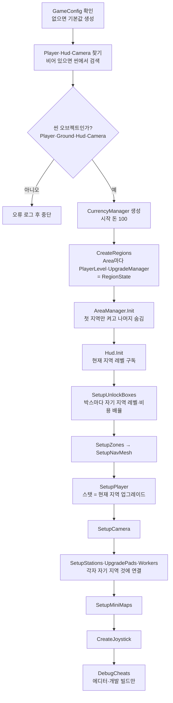
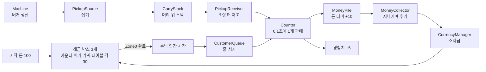
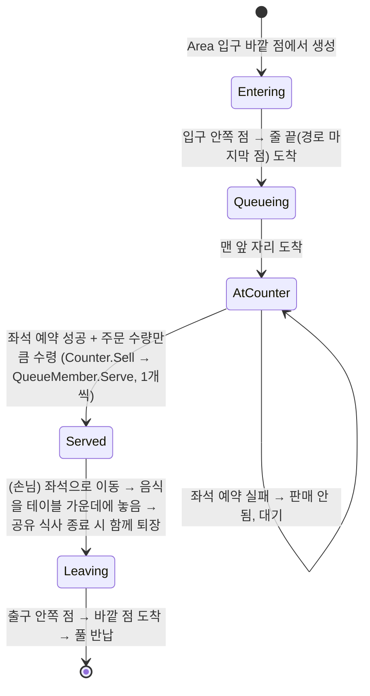

# Burger Idle — 개발 위키

> 코드 구조와 작업 규칙을 정리한 문서다. 기획은 [GDD.md](GDD.md), 진행 상황은 [Checklist.md](Checklist.md)를 본다.
> 기준 시점: P15 지역 확장 코드 작성 (P0~P12 완료)

---

## 1. 개요

| 항목 | 내용 |
| --- | --- |
| 장르 | 3D 쿼터뷰 레스토랑 운영 아이들 (레퍼런스: Burger Please!) |
| 엔진 | Unity 6000.3.25f1, URP 17.3 |
| 입력 | Input System 1.20 (레거시 `UnityEngine.Input` 사용 금지) |
| 반응형 상태 | R3 1.3.1 (`using R3;`, UniRx API 사용 금지) |
| 연출 | DOTween Pro (`using DG.Tweening;`) |
| UI 텍스트 | TextMeshPro |
| 플랫폼 | Android 세로 화면 (에디터 테스트는 Game 뷰 1080×1920) |
| 씬 | `Assets/Scenes/MainScene.unity` 하나 |

---

## 2. 핵심 설계 원칙

### 2.1 씬 배치 + 컴포넌트

- **맵에 고정된 오브젝트**(바닥, 플레이어, 카운터, 기계, 테이블, 쓰레기통, 해금 박스, 손님 줄)는 프리팹으로 만들어 **씬에 직접 배치**한다. 위치는 씬에서 눈으로 보며 잡는다.
- **실행 중 생겼다 사라지는 오브젝트**(음식, 쓰레기, 돈, 손님)만 코드가 `ObjectPools`로 생성한다.
- `GameBootstrap`은 오브젝트를 만들지 않고 **씬 오브젝트끼리 연결**만 한다. 예외는 조이스틱 UI 하나(코드 생성).
- `.unity` / `.prefab` 파일은 텍스트로 직접 편집하지 않는다. 에디터에서 작업한다.

### 2.2 R3 상태 관리

- 재화, 스탯, 개수 같은 상태는 `ReactiveProperty<T>`에 보관하고, 외부에는 `ReadOnlyReactiveProperty<T>`로만 노출한다.
- UI·연출은 `Update()` 폴링이 아니라 `Subscribe`로 갱신한다.
- 모든 구독과 `ReactiveProperty`는 `.AddTo(this)`로 해제를 보장한다.

```csharp
readonly ReactiveProperty<int> count = new ReactiveProperty<int>(0);
public ReadOnlyReactiveProperty<int> Count => count;

void Awake() => count.AddTo(this);
```

### 2.3 재화 단일 진입점

- 돈 증감은 **반드시 `CurrencyManager`** 를 거친다. 모든 지역이 지갑 하나를 공유한다. 음수 방지·최대값 검증은 이 클래스 안에서만 한다.
- 경험치는 지역마다 따로라서 **그 지역의 `PlayerLevel.AddExp()`** 를 거친다. 최대 레벨(지역 클리어)이면 더 쌓이지 않는다.
- 판매 수익과 팁은 바로 소지금이 되지 않는다. `MoneyPile`에 쌓였다가 플레이어가 수거할 때 `CurrencyManager.Add()`가 호출된다.

### 2.4 수치는 데이터로

밸런스 값은 코드에 하드코딩하지 않고 ScriptableObject에 둔다.

| 에셋 | 생성 메뉴 | 내용 |
| --- | --- | --- |
| `GameConfig` | `Create > BurgerIdle > Game Config` | 시작 돈, 플레이어 스탯, 판매가·경험치·판매 간격, 포장(버거 수·포장 배율·포장 간격·포장 버거 프리팹), 알바 인원·행동 속도 상한, 기계 생산량, 해금 시간, 카메라, 조이스틱, 돈 프리팹 |
| `CustomerConfig` | `Create > BurgerIdle > Customer Config` | 손님 이동속도, 입장 간격, 줄 간격, 최대 줄 길이 |
| `UnlockDefinition` | `Create > BurgerIdle > Unlock Definition` | 해금 항목 id, 이름, 비용, 필요 레벨, Grant Level, Unlock Message(해금 시 알림) |

`GameBootstrap`에 `GameConfig`를 연결하지 않으면 코드의 기본값 인스턴스를 만들어 쓴다.

### 2.5 물리를 쓰지 않는다

- 상호작용 범위는 콜라이더 대신 `InteractionZone`의 **XZ 평면 거리**로 판정한다.
- 손님·캐릭터 이동은 `Transform`만 사용한다. Rigidbody 없음. 프리팹에 남은 콜라이더는 지워도 된다.

---

## 3. 폴더·네임스페이스

```
Assets/
  Skripts/
    Core/       BurgerIdle.Core       부트스트랩, 설정, 풀, 카메라, 디버그
    Player/     BurgerIdle.Player     플레이어 이동·스탯
    Pickup/     BurgerIdle.Pickup     픽업 오브젝트, 머리 위 스택, 픽업·내려놓기 공용 부품
    Station/    BurgerIdle.Station    기계, 카운터, 쓰레기통
    Money/      BurgerIdle.Money      돈 오브젝트, 돈 더미, 수거
    Customer/   BurgerIdle.Customers  손님, 줄, 스포너  ← 폴더명과 네임스페이스가 다름 (클래스 Customer와 충돌 방지)
    Area/       BurgerIdle.Areas      지역(매장) 영역, 출입문, 지역 관리(AreaManager·RegionState)  ← 같은 이유로 네임스페이스가 복수형
    Unlock/     BurgerIdle.Unlock     해금 박스, 해금 구역, 해금 데이터
    Economy/    BurgerIdle.Economy    재화
    UI/         BurgerIdle.UI         HUD, 조이스틱
  Art/UI/       해금 박스용 스프라이트 (둥근 사각형, 테두리, 돈·자물쇠·별 아이콘)
  Prefab/       사용자가 만든 프리팹
  Words/        GDD.md, Checklist.md, Wiki.md
```

---

## 4. 초기화 흐름

`GameBootstrap`(MainScene의 `Bootstrap` 오브젝트)이 `Awake`에서 아래 순서로 연결한다.



알아둘 점:

- **비활성 오브젝트도 초기화한다.** 해금 전에는 카운터·기계가 꺼져 있으므로 `FindObjectsByType(..., FindObjectsInactive.Include, ...)`로 찾는다.
- **`Init`은 대상의 `Awake`보다 먼저 불릴 수 있다.** 씬 오브젝트 간 `Awake` 순서는 정해져 있지 않다. 그래서 `Init`에서는 값 저장과 구독만 하고, `Awake`에서 만드는 것에 의존하지 않는다.
- 플레이어에 `CarryStack`, `PickupInteractor`, `MoneyCollector`가 없으면 자동으로 붙인다.
- **지역 연결:** 시설·박스·패드·`WorkerManager`는 자기가 속한 Area(부모)의 지역(`RegionState`)에 연결된다. Area 밖에 있으면 첫 지역으로 처리하고, 지역이 2개 이상이면 경고를 남긴다.
- **열리지 않은 지역도 초기화한다.** `AreaManager.Init`에서 숨긴 뒤 초기화되고, 처음 들어갈 때 NavMesh를 굽는다.
- Bootstrap이 초기화하지 않는 컴포넌트(`CustomerSpawner`, `CustomerQueue`, `UnlockZone`, `PickupPile`, `PickupSource`, `PickupReceiver`, `TrashBin`)는 인스펙터 참조만으로 스스로 동작한다.

---

## 5. 게임 루프

### 5.1 전체 흐름



### 5.2 손님 상태



이 흐름은 `QueueMember`가 처리하고 손님(`Customer`)과 드라이브스루 차량(P11)이 공유한다. 손님은 `TryPrepareForService`(좌석 예약), `OnServed`·`UpdateServed`(테이블 이동·식사)를 재정의한다. 차량은 재정의 없이 받자마자 퇴장한다. 진상 손님(P13)은 아직 없다.

### 5.3 테이블 상태 (GDD 6.9)

| 이벤트 | 처리 |
| --- | --- |
| 좌석 예약 | 예약·착석 손님이 없는 좌석에 손님 지정, `SeatedSinceClean`+1 |
| 착석 | 손님 음식을 가운데 `FoodPile`에 추가. 식사 중이 아니면 식사 시작 |
| 식사 중 | `tableEatPerItem`(1.5초)마다 `FoodPile`에서 1개가 작아지며 사라짐. 더미가 비면 식사 종료 (식사 시간 = 버거 수 × 1.5초) |
| 강제 청소 | `SeatedSinceClean` ≥ 2 (`GameConfig.tableMustCleanCount`)면 새 예약 불가 |
| 식사 종료 | 먹은 버거 1개당 쓰레기 1개(가운데 `TrashPile`) → 앉은 손님마다 팁(× Tip Multiplier) → 앉은 손님 함께 퇴장 |
| 쓰레기 픽업 | `TrashPile`의 `PickupSource`로 1개씩 집어 감 |
| 초기화 | 예약·착석 손님 0명 && 쓰레기 0개 → `SeatedSinceClean` = 0 |

### 5.3 자동 상호작용 규칙

| 동작 | 조건 | 처리 |
| --- | --- | --- |
| 줍기 | `PickupSource` 범위 안 | 0.1초마다 1개. 최대적재량까지. 음식·쓰레기는 섞지 않음 |
| 내려놓기 | `PickupReceiver`·`TrashBin` 범위 안 | 0.1초마다 1개, 마지막에 쌓은 것부터. **줍기보다 우선** |
| 판매 | 플레이어가 `Counter`의 응대 위치에 있음 + 재고 있음 + 맨 앞 손님 대기 | 0.1초마다 1개 |
| 돈 수거 | `MoneyPile` 범위를 지나감 (멈출 필요 없음) | 0.05초마다 1개, 위층부터. 플레이어 전용 |
| 해금 투입 | `UnlockBox` 범위 안에서 **0.5초 이상 정지** | 비용 ÷ 1.5 / 초 속도로 투입. 부분 지불 가능 |

---

## 6. 스크립트 레퍼런스

### 6.1 Core

| 스크립트 | 역할 | 붙이는 곳 | 비고 |
| --- | --- | --- | --- |
| `GameBootstrap` | 씬 오브젝트 연결 (4장), 지역 이동 시 NavMesh 준비·순간이동 | MainScene의 `Bootstrap` 오브젝트 | 인스펙터: Config, Player, Ground(선택, NavMesh가 없을 때만), Hud, Main Camera, Areas(비우면 자동 탐색), Player Radius. 반드시 **씬 오브젝트**를 연결 (프리팹 에셋 연결 시 오류) |
| `GameConfig` | 전역 임시 수치 (ScriptableObject) | 에셋 | 2.4 참조 |
| `CameraFollow` | 고정 각도 쿼터뷰로 플레이어 추적 | Main Camera (Bootstrap이 자동 부착) | Pitch 50, Yaw 45, 거리 22. `Snap()`(순간이동 직후) |
| `ObjectPools` | 프리팹별 오브젝트 풀 (static) | — | `Get(prefab, pos, rot)` / `Release(instance)`. 꺼낸 오브젝트는 `ActiveParent`(현재 지역 Area) 아래에 생겨, 지역을 숨기면 함께 멈춘다 |
| `PooledObject` | 인스턴스가 자기 풀을 기억하는 핸들 | 풀이 자동 부착 | 직접 붙이지 않음 |
| `DebugCheats` | 테스트 키 | Bootstrap이 자동 부착 (에디터·개발 빌드만) | 9장 참조 |

### 6.2 Player

| 스크립트 | 역할 | 노출 값 |
| --- | --- | --- |
| `PlayerController` | 조이스틱(가상 게임패드 왼쪽 스틱) 또는 WASD로 이동. 카메라 기준 방향, NavMesh 안으로만 (NavMesh가 없는 씬은 바닥 범위) | `IsMoving` (해금 박스 정지 판정에 사용), `Teleport(position)` |
| `PlayerStats` | 플레이어 스탯 (일반 C# 클래스). 현재 지역 업그레이드 값을 따름 | `MoveSpeed`, `MaxCarry` |

### 6.3 Pickup — 픽업 공용 부품

스테이션은 아래 부품을 조합해 만든다 (7장).

| 스크립트 | 역할 | 주요 설정·API |
| --- | --- | --- |
| `PickupObject` | 집을 수 있는 물건. 음식·쓰레기 프리팹 루트에 붙임 | Kind(Burger / Coffee / Trash), Stack Height(스택 한 칸 높이). `Category` = Food 또는 Trash |
| `InteractionZone` | 상호작용 범위 (XZ 거리 원). 선택 시 초록 원으로 표시 | Radius, Offset. `Contains(position)` |
| `PickupPile` | 물건을 격자로 쌓아 보관. 한 층이 차면 위로 | Category, Capacity(0 = 무제한), Accepted Kinds(비우면 Category 전체, 카운터·포장 테이블은 코드가 지정), Origin(첫 칸 위치, 노란 상자로 표시), Columns·Rows·Spacing. `Add`, `TryTakeTop`, `TryConsume`, `CanAdd`, `SetCapacity`, `SetAcceptedKinds`, `TopKind`, `Count` |
| `PickupSource` | 범위 안 캐릭터가 Pile에서 집어 가게 함 | Pile(비우면 같은 오브젝트의 것) |
| `PickupReceiver` | 범위 안 캐릭터가 Pile에 내려놓게 함 | Pile(비우면 같은 오브젝트의 것) |
| `InteractionRegistry` | 활성화된 Source·Receiver 목록 (static) | `IPickupProvider`, `IPickupReceiver` 인터페이스 정의 |
| `CarryStack` | 캐릭터 머리 위 스택. 이동하면 위쪽일수록 늦게 따라오며 흔들림 | Anchor(비우면 높이 2.1에 자동 생성), Sway 값. `Push`, `Pop`, `Peek`, `FindFromTop`, `Take`(중간 물건 꺼내기), `Clear`(모두 버림, 지역 이동 시), `CanAccept`, `Count`, `Category` |
| `PickupInteractor` | 주변 Source·Receiver와 자동 상호작용. 내려놓기는 받는 곳이 받을 수 있는 것 중 가장 위에 있는 것부터 | 플레이어 전용 (알바는 `Worker`가 직접 처리) |

### 6.4 Station

| 스크립트 | 역할 | 필요 구성 |
| --- | --- | --- |
| `Machine` | 일정 간격으로 음식 생산 → 출력 Pile에 쌓음. 재고 상한에서 멈춤 | 같은 오브젝트에 `PickupPile`. Product에 음식 프리팹. `ProducePerSecond`, `MaxStock` (P8 업그레이드 대상) |
| `Counter` | 판매. 경험치는 자기 지역 레벨로. 판매가·경험치는 종류별(`GameConfig.PriceOf/ExpOf`: 버거 10·5, 포장 버거 = 버거 × 4 × 1.5), 물건이 손님·차량 머리 위로 전달. 알바 간격 = 1초 ÷ 행동 속도. 드라이브스루 카운터도 이 컴포넌트 | Sell Kind(일반 Burger, 드라이브스루 Packed Burger → 재고 Pile이 이 종류만 받음), Stock, Service Point, Queue(드라이브스루는 차량 줄), Money Pile. `ISupplyTarget` |
| `PackingTable` | 포장. 투입 칸 버거 4개 이상 + 출력 칸 여유 + 포장 위치에 사람 → 진행도가 차면 버거 4개 소모, 포장 버거 1개 출력. 자리 비우면 진행도 유지 | Input Capacity(버거, 기본 8, 0 = 무제한), Output Capacity(포장 버거, 4). Input·Output의 PickupPile Capacity는 이 값으로 덮어씀, Pack Point, Gauge Root·Gauge Fill(선택). 플레이어 0.5초, 알바 2초 ÷ 행동 속도. `ISupplyTarget`(버거) |
| `SupplyTargets` | 물건을 채워 줘야 하는 곳 목록 (`ISupplyTarget`: Kind, Shortage, Receiver) | 카운터·드라이브스루(줄 남은 주문량 − 재고), 포장 테이블(출력 칸을 채우는 데 필요한 버거). 알바 운반 판단용 |
| `TrashBin` | 쓰레기를 받아 풀에 반납. 용량·보상 없음 | 같은 오브젝트에 `InteractionZone` |
| `Table` | 2인 합석 테이블. 좌석 예약, 가운데 공유 음식으로 함께 식사, 쓰레기·팁, 강제 청소 (5.3) | Seats[2](Sit Point = 손님 위치·방향), Food Pile·Trash Pile(가운데, `PickupPile` 재사용), Tip Pile. `TryReserveNearest`, `SeatedSinceClean`, `TrashCount`, `IsMustClean` |

### 6.5 Money

| 스크립트 | 역할 | 비고 |
| --- | --- | --- |
| `MoneyObject` | 돈 오브젝트. 생성 시점의 금액(`Amount`) 보관 | 돈 프리팹 루트에 붙이고 `GameConfig.moneyPrefab`에 연결 |
| `MoneyPile` | 돈 더미. 가로 4 × 세로 2 격자, 차면 위층, 10층 초과분은 마지막 돈에 합산. 쌓을 때 수익 배율 적용 | `InteractionZone` 필요. `Add(amount, from)`, `TryTakeTop`, `TotalAmount`. 선택 시 초록 사각형으로 영역 표시 |
| `MoneyCollector` | 플레이어 전용 수거. 돈이 플레이어를 따라 날아오고 도착 시 소지금 추가 | Bootstrap이 플레이어에 자동 부착 |

### 6.6 Customers

| 스크립트 | 역할 | 비고 |
| --- | --- | --- |
| `QueueMember` | 줄 서는 대상의 공통 동작 (추상 클래스, 5.2 상태). 입구 → 줄 → 주문 수량만큼 수령 → 출구 | `Begin(queue, 입구 안쪽 점, 출구 경로)`, `Serve(food)`(1개씩, 머리 위에 쌓음), `State`, `OrderCount`, `ReceivedCount`. 재정의: `RollOrderCount`, `TryPrepareForService`, `OnServed`, `UpdateServed`. Item Anchor(비우면 높이 2.1) |
| `Customer` | 매장 손님 (`QueueMember` 상속). 좌석 예약 → 주문 수령 → 좌석으로 직선 이동 → 테이블 공유 식사 → 함께 퇴장 | 프리팹 루트는 **발 위치(Y 0)**. Order Range(일반 1~4, VIP 6~10), Tip Multiplier(일반 1, VIP 3). 일반·VIP는 같은 컴포넌트, 프리팹만 다름 |
| `DeliveryConfig` | 배달 데이터 (ScriptableObject, `Create > BurgerIdle > Delivery Config`) | 품목(버거), 수량 5~10, 제한 시간 90초, 보상 배율 2, 첫 등장 5초, 재등장 30초, 이동속도, 급한 시간 20초, 품목 아이콘 |
| `DeliveryPoint` | 배달 지점. 배달원이 주문 중일 때만 받는 곳(`IPickupReceiver`) + 채울 곳(`ISupplyTarget`, 우선순위 Order/Urgent)으로 등록 → 플레이어 자동 제출·알바 운반 | `InteractionZone` 필요(제출 범위). Stand Point(배달원 서는 위치·방향, 비우면 자기 자신) |
| `DeliveryRider` | 배달원. 입구 → 배달 지점 → 주문(제한 시간) → 성공·실패 → 출구 → 풀 반납. 제출분은 머리 위에 쌓이고 실패 시 삭제 | 프리팹 루트(발 위치 Y 0). Item Anchor |
| `DeliverySpawner` | 배달원 보내기. Open Zone(비우면 속한 Zone의 Facilities) 해금 후, 한 번에 1명, 종료 후 재등장. 성공 보상(판매가·경험치 × 수량 × 배율, 돈은 수익 배율) 즉시 입금, 알림(SPECIAL ORDER!·성공·실패) | Prefab, Config, Point, Area, 사람 입구·출구 |
| `DeliveryBubble` | 배달원 말풍선. 주문 중에만, 남은 시간(분:초, 급하면 빨강)·제출/필요·아이콘, 카메라를 향함 | 배달원 프리팹 안 World Space Canvas. Root, Time Text, Count Text, Icon(선택). "SPECIAL ORDER"는 고정 텍스트 |
| `Vehicle` | 드라이브스루 차량 (`QueueMember` 상속, 기본 동작). 포장 버거 1개 받으면 바로 차량 출구로 퇴장 | 프리팹 루트 발 위치(Y 0). Item Anchor로 받은 봉투 위치 지정(창문 쪽). 스포너는 `CustomerSpawner` 재사용(Vehicle Entrance / Vehicle Exit) |
| `CustomerQueue` | 경로 점을 따라 슬롯 자동 계산. 앞이 비면 경로 따라 전진. 차량 줄에도 재사용 | Path: P0 = 카운터 앞(맨 앞), 마지막 = 줄 끝(입구 쪽). 꺾인 줄 가능. 노란 선·원으로 표시 |
| `CustomerSpawner` | Area 입구에서 입장 간격마다 생성. 줄이 차면 멈춤 | Prefab(`QueueMember`), **Variants**(프리팹 + 가중치, 예: 일반 9 : VIP 1), Queue, **Area**, Entrance Type·Exit Type(기본 사람 입구·출구, 차량은 차량 입구·출구), **Open Zone**(이 구역 완료 후 시작, 비우면 즉시) |
| `CustomerConfig` | 손님(또는 차량) 수치 | 2.4 참조. 차량은 별도 에셋 |

### 6.6.1 Areas · 공용 이동

| 스크립트 | 역할 | 비고 |
| --- | --- | --- |
| `Area` | 지역(매장) 하나의 전체 영역. 출입문 목록, 지역 설정 | Gates 비우면 자식 `AreaGate` 자동 수집. `TryGetGate(type)` — 같은 종류가 여러 개면 무작위. 지역 칸: Display Name(비우면 "지역 N"), Unlock Cost Multiplier, Income Multiplier, Income Per Minute, Start Point(비우면 ZoneStart 바닥 중앙), Map Position |
| `AreaManager` | 지역 관리. 자식 Area를 Hierarchy 순서대로 사용, 현재 지역만 켜고 나머지 숨김(멈춤), 클리어 시 다음 지역 열기·알림, 마지막 지역 클리어 = 데모 완료, 떠난 클리어 지역 지속 수입 적립 | `Areas` 오브젝트에 부착. Income Cap Minutes(120), Open Message Format, Demo Complete Message. `Regions`, `Current`, `IsFinished`, `Enter(region)`, `Collect(region)` |
| `RegionState` | 지역 하나의 데이터 묶음 (일반 C# 클래스): `PlayerLevel`, `UpgradeManager`, 열림·클리어, 지속 수입 적립액, 수익 배율(플레이어 업그레이드 × 지역 배율) | `IsOpen`, `IsCleared`(레벨이 Max Level), `StoredIncome`, `Accrue`, `TakeIncome`, `IncomeMultiplier`. 파일 저장(P14)은 이 묶음을 직렬화 |
| `AreaGate` | 출입문. 바깥 점 → 안쪽 점 | Usage 체크(사람 입구·출구, 차량 입구·출구, 겸용 가능), Outside·Inside 연결. 씬 뷰에 화살표(사람 초록, 차량 하늘색) |
| `RouteWalker` | 여러 점을 차례로 직선 이동 (일반 C# 클래스, Core) | 손님·차량·배달원의 출입문 경유 이동. `Start(points)`, `Step(transform, speed, turn)` |

### 6.7 Unlock

| 스크립트 | 역할 | 비고 |
| --- | --- | --- |
| `UnlockDefinition` | 해금 데이터 (id, 이름, 비용, 필요 레벨, Grant Level = 해금 시 이 레벨까지 올림) | 씬 오브젝트는 참조할 수 없어서 해금 대상은 박스에서 연결 |
| `UnlockBox` | 해금 박스. 0.5초 정지 후 투입, 부분 지불·재개, 완료 시 박스 사라지고 대상이 튀어나옴. 필요 레벨·Grant Level은 자기 지역 레벨 | `InteractionZone` 필요. Target은 **박스의 자식이면 안 됨**(같이 사라짐). 시작 시 Target 자동 숨김. `Cost`(Definition 비용 × 지역 비용 배율), `Paid`, `IsUnlocked` |
| `Zone` | 구역 하나. Floor·RemoveOnExpand·Expansion·Facilities 연결 (비우면 같은 이름 자식 자동 탐색) | Expansion 없으면 시작 공간. 칸마다 연결 대상 툴팁. 확장 박스에 Target이 있으면 경고 |
| `ZoneManager` | 구역을 순서대로 엶. 이전 Zone 시설 완료 → 확장 박스 → Floor 솟아오름/RemoveOnExpand 내려감 → 시설 박스. 시설 없는 Zone은 열리자마자 다음 확장 박스 | `Zones` 오브젝트에 부착. 자식 `Zone`을 Hierarchy 순서대로 사용. Move Distance. GameBootstrap이 NavMesh 굽기 전에 Init | Boxes 비우면 자식 박스 자동 수집. Zone0 완료 = 손님 입장 시작 |

`UnlockBox`의 비주얼은 바닥에 눕힌 World Space Canvas다.

| 인스펙터 | 연결 대상 |
| --- | --- |
| Visual Root | Canvas (돈 도착 시 살짝 튐) |
| Fill Image | Image Type = Filled, Vertical, Origin Bottom |
| Cost Group / Cost Text | 비용 숫자 + 돈 아이콘 묶음 |
| Locked Group / Level Text | 자물쇠 + "Lv N" + 별 묶음 (레벨 검사는 P8) |

### 6.8 Economy · UI

| 스크립트 | 역할 | 비고 |
| --- | --- | --- |
| `CurrencyManager` | 돈 단일 진입점 (일반 C# 클래스, 모든 지역 공유) | `Add(type, amount)`, `TrySpend(type, amount)`(전액 가능할 때만), `SpendUpTo(max)`(가진 만큼 차감, 실제 금액 반환), `Money` |
| `LevelTable` | 경험치 → 레벨 곡선 (ScriptableObject) | Lv N → N+1 = round(Base Exp × Growth^(N-1)). Start Level(기본 0). **Max Level = 지역 클리어 레벨(11)**. `GameConfig.levelTable` (비우면 기본값 50, ×1.5, 최대 20). 모든 지역이 같은 것을 씀 |
| `PlayerLevel` | 지역 하나의 경험치·레벨 (일반 C# 클래스, 지역마다 하나) | `AddExp`, `Exp`, `Level`, `ExpInLevel`, `ExpToNext`, `Progress`(0~1), `MaxLevel`, `RaiseTo`. 레벨 = max(경험치 레벨, `RaiseTo`로 받은 레벨), 받은 레벨이 0이면 경험치와 관계없이 0. 최대 레벨이면 경험치 안 쌓임. 업그레이드·해금 박스·HUD가 구독 |
| `Hud` | HUD 진입점. 자식의 화면 요소를 찾아 초기화하고, 레벨업 시 알림을 띄움. 레벨은 현재 지역 것 | HUD Canvas 루트에 부착. 인스펙터 칸 없음. `Notifications`로 다른 시스템이 알림 사용 |
| `MoneyView` | 소지금 표시 | 돈 묶음 프리팹 루트. Money Text(`CountUpText`) |
| `LevelView` | 현재 지역의 "Lv N", 경험치 바, "현재 / 필요량"(최대 레벨이면 MAX), 레벨업 시 숫자 튐. 지역을 옮기면 그 지역 값으로 바뀜 | 레벨 묶음 프리팹 루트. Level Text, Exp Bar(Filled), Exp Text |
| `NotificationPopup` | 범용 알림 팝업. 연달아 오면 차례로 표시 | 알림 프리팹 루트(CanvasGroup 필요). Message Text, Hold Duration. `Show(message)` |
| `CountUpText` | 숫자 카운트업 + 증가 시 튐 (공용) | 숫자 TMP 텍스트에 부착. Format(`{0:N0}`), Duration, Punch Scale |
| `VirtualJoystick` | 플로팅 조이스틱. 터치한 곳에 나타남. On-Screen Control로 가상 게임패드 스틱에 값 전달 | Bootstrap이 코드로 생성. Canvas Sort Order -100 |
| `UiSprites` | 런타임 원형 스프라이트 생성 | 조이스틱용 |
| `OrderBubble` | 줄 맨 앞 손님의 주문 말풍선 "받은 수/주문 수". 카메라를 향함 | 손님 프리팹 안 World Space Canvas에 부착. Root, Count Text. VIP는 프리팹에서 색 변경 |
| `MiniMapView` | 미니맵. 나침반 버튼으로 열기, 지역 아이콘 자동 생성(위치 = Area의 Map Position), 드래그 이동, 매장 UI 밖을 누르면 매장 UI 닫기, 열려 있는 동안 게임 정지, X·뒤로가기(Esc)로 닫기, 열기·닫기·입장 시 페이드 | HUD Canvas 안 항상 켜진 오브젝트에 부착, 실제 화면은 자식 Window. Open Button(나침반), Close Button, Window, Fader, Scroll Rect, Content(Anchor·Pivot 가운데), Icon Prefab, Popup, Follow Icon·Popup Offset |
| `MiniMapStoreIcon` | 미니맵 매장 아이콘. 잠김(자물쇠·어둡게)·클리어·현재 지역 표시 | 아이콘 프리팹 루트. Button, Name Text, Locked Mark, Cleared Mark, Current Mark, Body(어둡게 할 그림) |
| `MiniMapStorePopup` | 매장 UI. 열린 지역 = 입장, 클리어 지역 = 입장·수거 + 분당 수입·쌓인 금액(상한이면 MAX), 잠긴 지역 = 오픈 조건 안내 | Window 안(Content 밖). Name Text, Income Group·Income Text, Stored Text, Lock Text, Enter Button, Collect Button |
| `ScreenFader` | 화면 페이드 (시간 배율 무시) | 전체 화면 검은 Image + CanvasGroup, 다른 UI보다 위. Duration(0.3초) |

### 6.10 Workers (네임스페이스 BurgerIdle.Workers)

| 스크립트 | 역할 | 비고 |
| --- | --- | --- |
| `Worker` | 알바 (`WorkerManager` 아래에 생성, 지역을 떠나면 함께 멈춤). 일 고르기 → NavMesh 이동 → 작업 → 다음 일. 동적 우선순위: 들고 있는 것 처리 > 막힌 좌석·강제 청소 > 판매(`Counter.NeedsSeller`, 일반·드라이브스루) > 포장(`PackingTable.NeedsPacker`) > 운반(모자란 `ISupplyTarget` → 그 종류를 내주는 가까운 곳, 많이 모자란 곳 우대) > 일반 청소, 같으면 가까운 순 | 프리팹 루트에 `NavMeshAgent` + `CarryStack` + `Worker`. 지나가며 자동 줍기 없음. 할 일 없으면 제자리 대기. 회피(Obstacle Avoidance) 끔 → 알바·플레이어끼리 밀지 않고 겹쳐 지나감. 작업 중 위치를 벗어나면 다시 걸어감 |
| `TaskBoard` | 작업 대상 예약 (static) | 한 대상은 알바 한 명만 |
| `WorkerManager` | 인원수 스탯이 오르면 직원 대기 지점에서 알바 생성. 지역마다 Area 안에 하나 | Prefab, Spawn Point |

가로채기: 이동 중 대상이 비거나(플레이어가 가져감), 플레이어가 응대 위치에 들어오면 일을 포기하고 예약을 푼 뒤 다음 일을 고른다. `Counter`는 플레이어가 응대 위치에 있으면 플레이어 간격, 없으면 도착한 알바의 간격(1초 ÷ `WorkerActionSpeed`)으로 판다. `PackingTable`도 같은 방식(플레이어 0.5초, 알바 2초 ÷ 행동 속도). NavMesh는 `GameBootstrap.SetupNavMesh`가 시작 시·해금 후 다시 굽는다.

### 6.9 Upgrade

| 스크립트 | 역할 | 비고 |
| --- | --- | --- |
| `UpgradeDefinition` | 업그레이드 항목 (ScriptableObject) | Category(Player·Machine·Table·Worker), Stat(StatKey), 필요 레벨, 최대 레벨, Base Cost·Cost Growth, Value Per Level(줄일 스탯은 음수), Value Format. 알바 Stat: WorkerCount(0~6), WorkerMoveSpeed, WorkerMaxCarry, WorkerActionSpeed(판매·포장 속도 배율 1~5배) |
| `UpgradeManager` | 업그레이드 레벨·스탯 값 관리 (일반 C# 클래스, 지역마다 하나, 플레이어 항목 포함). 광고 업그레이드(`TryUpgradeByAd`, 항목별 재사용 대기) 포함 | `Stat(key)` = GameConfig 기본값 + Σ 레벨 × 변화량 (스탯별 최소·최대 범위로 제한, 범위 끝이면 MAX). `TryPurchase`(레벨·돈 확인 후 구매), `LevelOf`, `IsLocked`, `IsMaxed`, `CurrentCost` |
| `UpgradePad` | 바닥 패드. 들어가면 자기 지역 업그레이드로 패널 열림, 벗어나면 닫힘 | `InteractionZone` 필요. Title(패널 제목), Categories(비우면 전체) |
| `UpgradePanel` | 업그레이드 패널 (모든 지역이 하나를 같이 씀). 열릴 때 패드가 넘긴 지역 업그레이드로 카드 생성 | HUD Canvas 안. Window(자식), Canvas Group, Content(Horizontal Layout Group), Title Text, Close Button, Entry Prefab |
| `UpgradeEntryView` | 업그레이드 카드 한 장 | 카드 프리팹 루트. Name Text, Icon Image(데이터의 Icon), Pip Container + Pip Prefab(최대 레벨 수만큼 칸 생성, 산 만큼 채움), Ad Button + Ad Text(무료·광고 중·대기 초), Money Button + Cost Text, 선택: Value·Lock Text |

스탯을 쓰는 쪽: `PlayerStats`(이동속도·적재량), `MoneyPile`(수익 배율, `CurrencyManager.ApplyMultiplier`로 반올림), `Machine`(생산량·최대 재고, 매 프레임 현재 값 읽음), `Table`(버거 1개 먹는 시간). 새 스탯을 추가하려면 `StatKey`에 항목을 넣고 `GameBootstrap.CreateUpgrades`에 기본값을 등록한다.

---

## 7. 조립 레시피

### 7.0 Hierarchy 구조

```
[Systems]                  ← Bootstrap(GameBootstrap), WorkerManager 등 로직
[UI]                       ← Canvas (HUD, UpgradePanel, NotificationPopup)
Areas                      ← AreaManager (자식 Area의 Hierarchy 순서 = 지역 순서)
└─ Area                    ← Area + NavMeshSurface (지역 하나, 크기 1. 지역끼리 겹치지 않게 떨어뜨림)
   ├─ Gates                ← 출입문
   ├─ Routes               ← 손님 줄·차량 줄 + 경로 점
   ├─ Spawners             ← 손님·차량 스포너
   ├─ StaffPoint           ← 직원 대기 지점
   ├─ WorkerManager        ← 그 지역 알바
   └─ Zones                ← ZoneManager
   ├─ ZoneStart            ← Zone (시작 공간: Expansion 없음, 매장 밖)
   │  └─ Floor             ← 바깥 바닥 (GameBootstrap Ground)
   ├─ Zone0                ← Zone (매장)
   │  ├─ Floor             ← 매장 바닥·벽·쓰레기통 (확장 시 솟아오름)
   │  ├─ Expansion         ← 매장을 여는 UnlockBox (Target 비움, 매장 입구에 배치)
   │  ├─ Facilities        ← UnlockZone + 해금 박스들 (TableSet 등)
   │  └─ Objects           ← 시설 본체 (해금 박스의 Target), 손님 줄
   ├─ Zone1                ← Zone (업그레이드 공간)
   │  ├─ Floor             ← 확장 시 솟아오름
   │  ├─ Expansion         ← Zone1을 여는 UnlockBox (Zone0 바닥 위에 놓여도 Hierarchy는 Zone1 아래)
   │  ├─ Facilities        ← 업그레이드 패드 세트들
   │  └─ Objects
   └─ Zone2                ← Zone (드라이브스루, 마지막)
Player / Main Camera / Directional Light
```

- 그룹 오브젝트(Area, Zones, ZoneN, Floor, Objects 등)는 위치·회전 0, 크기 1로 둔다. Zone 루트는 위치를 옮겨도 된다(자식이 그 기준으로 배치됨).
- 새 Zone은 직전 Zone을 복제해 내용을 바꾸고, ZoneManager는 Hierarchy 순서대로 연다.
- **확장 박스는 "그 Zone을 여는 박스"다.** 이전 Zone 아래에 두거나 Target에 다음 Zone을 넣지 않는다 (Target이 있으면 경고). Facilities 안의 시설 박스를 확장 박스로 연결하지 않는다 (숨겨진 Facilities 안이라 영영 보이지 않음, 경고).
- **칸막이 벽:** 이전 Zone Floor 안의 경계 벽을 다음 Zone의 `Remove On Expand` 칸에 직접 연결한다.
- Facilities가 없는(해금 박스 0개) Zone은 열리자마자 다음 확장 박스가 나타난다. 시작 공간이면 처음부터 나타난다.
- Objects 안의 오브젝트는 해금 박스의 Target이어야 해금 전에 숨겨진다. 쓰레기통처럼 Zone과 함께 나타날 것은 Floor에 넣는다.
- **세트 프리팹:** 해금 박스와 시설을 빈 루트 아래 형제로 둔다 (`TableSet` = UnlockBox_Table + Table, Target = 옆의 Table). 시설을 박스의 자식으로 두면 해금 후 박스와 함께 꺼진다. 세트는 Facilities 아래에 둔다.
- 손님 스포너는 Facilities 밖에 둔다 (Facilities 안에 있으면 확장 전에 꺼져 있음). Open Zone을 비우면 스포너가 속한 Zone의 Facilities를 쓴다.
- **NavMesh:** NavMeshSurface(Collect Objects All, Render Meshes)는 씬의 모든 메시를 굽는다. 움직이는 오브젝트(손님, 픽업 물건, 돈, 플레이어)는 `NavMeshIgnore`가 `NavMeshModifier`(Ignore From Build)를 붙여 제외한다. 알바는 NavMeshAgent라 자동 제외. 새로 움직이는 오브젝트 종류를 만들면 Awake에서 `NavMeshIgnore.Mark(gameObject)`를 부른다.

컴포넌트는 **스케일 1인 빈 오브젝트**에 붙이고, 모양용 도형은 자식으로 둔다. 스케일이 1이 아니면 쌓인 물건까지 같이 커지거나 줄어든다.

| 오브젝트 | 컴포넌트 조합 | 설정 |
| --- | --- | --- |
| 버거 기계 | `PickupPile` + `InteractionZone` + `PickupSource` + `Machine` | Pile Category Food, Machine Product = 버거 프리팹 |
| 카운터 | `PickupPile` + `InteractionZone` + `PickupReceiver` + `Counter` | Pile Category Food, Sell Kind Burger. 자식으로 ServicePoint(`InteractionZone`), MoneyPile(`InteractionZone` + `MoneyPile`) |
| 드라이브스루 카운터 | 카운터와 같음 | Sell Kind **Packed Burger**, Queue = 차량 줄. ServicePoint는 창구(직원이 서는 매장 안쪽) |
| 포장 테이블 | 루트 `PackingTable` + 자식 Input(`PickupPile` Food + `InteractionZone` + `PickupReceiver`), Output(`PickupPile` Food + `InteractionZone` + `PickupSource`), PackPoint(`InteractionZone`), Gauge(World Space Canvas + Filled Image, 선택) | 받는 종류·상한은 코드가 설정. Input·Output·PackPoint의 범위가 겹치지 않게 |
| 포장 버거 | 루트(스케일 1) `PickupObject`(Kind Packed Burger, Stack Height ≈ 봉투 높이) + 자식 모양 | `GameConfig.Packed Burger Prefab`에 연결 |
| 차량 | 루트(스케일 1, 발 위치 Y 0) `Vehicle` + 자식 모양 | 차량용 `CustomerConfig`(속도 4, 간격 3.0, 최대 4대, 입장 6초)를 차량 줄에 |
| 쓰레기통 | `InteractionZone` + `TrashBin` | — |
| 테이블 | `Table` + 자식 Sit Point 2개 + 가운데 FoodPile(`PickupPile` Food, Capacity 0) + 가운데 TrashPile(`PickupPile` Trash, Capacity 0 + `InteractionZone` + `PickupSource`) + 옆에 MoneyPile(팁 더미) | Sit Point의 정면(파란 화살표)이 테이블을 향하게. 두 Pile은 테이블 윗면, Columns·Rows 2 |
| 해금 박스 | `InteractionZone` + `UnlockBox` + 자식 World Space Canvas | 루트 Rotation Y 45(카메라 방향), Canvas Rotation X 90, Scale 0.01, **Graphic Raycaster 제거** |
| 해금 구역 | `UnlockZone` + 자식 해금 박스들 | — |
| 업그레이드 패드 | `InteractionZone` + `UpgradePad` + 바닥 표시 | Categories로 보여 줄 종류 지정 |
| 업그레이드 패널 | HUD Canvas 안 `UpgradePanel` 오브젝트 + 자식 Window(Canvas Group, Content) | Window는 패널 오브젝트의 자식. 버튼만 Raycast Target 켜기 |
| 업그레이드 항목 프리팹 | 루트 `UpgradeEntryView` + TMP 텍스트들 + Button | Panel의 Entry Prefab에 연결 |
| 손님 줄 | `CustomerQueue` + 자식 경로 점 | Config 연결 |
| 손님 프리팹 | 루트(발 위치) `Customer` + 자식 모양 | — |
| 매장 영역 | `Area` + 자식 출입문들 | — |
| 출입문 | `AreaGate` + 자식 빈 오브젝트 Outside(매장 밖), Inside(문 안쪽) | Usage 체크. 사람 문 하나를 입구·출구 겸용 가능 |
| 손님 스포너 | `CustomerSpawner` | Area 연결, Entrance Type = People Entrance, Exit Type = People Exit |
| 음식·쓰레기 프리팹 | 루트 `PickupObject` | Kind, Stack Height |
| 돈 프리팹 | 루트 `MoneyObject` | 크기 비율 1 × 2 × 0.2 (예: 0.25 × 0.05 × 0.5) |

---

## 8. 확장 가이드

### 8.1 새 음식 추가 (예: 커피)
1. `PickupKind`에 이미 `Coffee`가 있다. 새 종류가 필요하면 enum에 추가한다. 음식은 모두 `Category.Food`로 묶인다.
2. 프리팹을 만들고 `PickupObject`(Kind 지정)를 붙인다.
3. 기계 레시피(7장)대로 새 기계를 배치하고 Product에 연결한다.

### 8.2 새 해금 항목·구역 추가
1. `UnlockDefinition` 에셋을 만든다 (비용, 필요 레벨).
2. 해금 박스 프리팹을 배치하고 Definition과 Target(씬에 미리 배치한 오브젝트)을 연결한다.
3. 구역 단위로 묶으려면 새 `UnlockZone`의 자식으로 넣는다. 구역 순차 노출(`ZoneManager`)은 P10.
4. Target 안의 컴포넌트(`Machine`, `Counter`, `MoneyPile`)는 비활성 상태여도 Bootstrap이 초기화한다.

### 8.3 오브젝트 풀 사용
```csharp
var item = ObjectPools.Get(prefab, position, Quaternion.identity); // 활성화 + 부모 해제
item.Release();                     // PickupObject·MoneyObject
ObjectPools.Release(component);     // 그 외 컴포넌트
```
- 반납 시 자동 처리: `transform.DOKill()`, 부모를 `[Pools]`로 이동, 크기를 프리팹 값으로, 회전 초기화, 비활성화.
- 트윈을 풀 오브젝트에 걸 때는 대상을 `transform`으로 두거나 `SetTarget(transform)`을 지정해야 반납 시 함께 정리된다.
- 같은 인스턴스를 두 번 반납하면 예외가 난다 (풀의 중복 반납 검사).

### 8.4 static 상태
`ObjectPools`, `InteractionRegistry`, `MoneyPile.Active`는 static이다. Domain Reload를 꺼도 Play 시작 시 비워지도록 `[RuntimeInitializeOnLoadMethod(SubsystemRegistration)]`로 초기화한다. 새 static 목록을 만들 때도 같은 방식을 쓴다.

---

## 9. 디버그·문제 해결

### 9.1 치트 키 (에디터·개발 빌드, 키보드 전용)

| 키 | 동작 |
| --- | --- |
| M | 돈 +10 |
| K | 돈 +100 |
| N | 돈 30 지불 (`TrySpend`, 부족하면 실패) |
| B | 돈 최대 30 지불 (`SpendUpTo`, 가진 만큼) |
| E | 현재 지역 경험치 +5 |
| L | 현재 지역 레벨 +1 (레벨 0이면 1) |
| R | 다음 열린 지역으로 이동 (미니맵 없이) |
| T | 게임 속도 1배 ↔ 3배 |

### 9.2 자주 나는 설정 실수

| 증상 | 원인 | 해결 |
| --- | --- | --- |
| 화면이 멈춘 것처럼 보이고 플레이어가 안 움직임 | 투명한 UI(Panel 등)의 Raycast Target이 켜져 조이스틱 입력을 가로챔 | 버튼이 아닌 UI 요소는 Raycast Target 끄기. World Space Canvas의 Graphic Raycaster 제거 |
| 실행 시 UI만 뜨고 아무것도 없음 | Bootstrap에 프리팹 에셋(Project 창)을 연결함 | Hierarchy의 씬 오브젝트 연결. Console의 `[GameBootstrap]` 오류 확인 |
| 공급기·기계에서 물건이 안 나옴 | `PickupPile` Category와 프리팹 Kind 불일치 | Console의 `[Machine]` 경고 확인 후 Category 수정 |
| 물건이 받침대에 파묻힘 | `PickupPile` Origin 높이 | Origin Y를 받침대 윗면 높이로 |
| 해금 후 대상이 안 나타남 | Target이 박스의 자식 | Target을 박스 밖으로 이동 |
| 손님이 안 나옴 | Open Zone 미완료 또는 미연결 | `[UnlockZone] ... 해금 완료` 로그 확인 |
| `[CustomerSpawner] ... 출입문이 없습니다` | Area에 해당 종류 문이 없거나 Outside·Inside 미연결 | `AreaGate`의 Usage 체크와 두 점 연결 확인 |
| `[UnlockZone] ...: 해금 박스가 없습니다.` | 엉뚱한 오브젝트에 `UnlockZone`이 붙음 | 해당 컴포넌트 제거 |
| TMP 글자가 □로 표시 | 기본 폰트(LiberationSans)에 한글 없음 | 한글 TMP 폰트 에셋을 Fallback에 추가 |
| `MissingReferenceException: ... GameObjectInspector` | Unity 에디터 내부 오류 (Play 종료 시 인스펙터 대상 소멸) | 무시해도 됨 |

---

## 10. 예정 작업과 미정 사항

| Phase | 내용 |
| --- | --- |
| P6 | Area·출입문 (사람·차량 입구·출구), 손님 스포너를 출입문 기반으로 전환 |
| P7 | 테이블 2인 합석, 빈 좌석 예약 후 판매, 식사·팁 더미, 쓰레기 축적, 강제 청소 |
| P8 | 레벨업(`LevelTable`), 업그레이드 데이터·패널, 해금 박스 레벨 검사 |
| P9 | 알바 AI(`TaskBoard`), 플레이어 가로채기, 알바 판매 간격 1초 → 업그레이드로 감소 (P11에서 행동 속도로 변경) |
| P10 | `ZoneManager`, ZoneStart(매장 밖) → Zone 0(매장 구매) → Zone 1(플레이어·알바 업그레이드 패드) |
| P11 | Zone 2 드라이브스루: 받는 종류 필터, 포장 테이블, 포장 버거, 차량 손님 |
| P12 | Zone 3 배달: `DeliveryPoint`(주문 중에만 받는 곳), `DeliveryRider`, `DeliverySpawner`, `DeliveryBubble`, 즉시 입금 |
| P13 | 진상 손님, 연출 정리, 종료 화면 |
| P14 | 저장/불러오기, 오프라인 보상 |
| P15 | 지역(Area) 확장: `AreaManager`, 지역별 레벨·업그레이드(`RegionState`), 클리어 시 다음 지역, 지속 수입, 미니맵 |

미정 사항 전체 목록은 [GDD.md](GDD.md) 14장을 본다. 주요 항목:
- 카운터 재고 상한 (현재 무제한)
- 테이블 강화 단위 (전체 공통 / 테이블별)
- 알바 역할(Role) 분리 여부
- 커피 해금 후 손님 주문 종류
- 저장 범위, 오프라인 보상 계산식
